  

**Senior Frontend-разработчик** из Санкт-Петербурга. 8 лет в коммерческой разработке: Next.js, React,
TypeScript. Делаю интерфейсы, которые быстро грузятся и не бесят, собираю UI-библиотеки, слежу за
производительностью и SEO. В работе активно использую AI-агентов: Claude Code, Cursor, MCP.

**Портфолио:** [mirudistok32.github.io/portfolio](https://mirudistok32.github.io/portfolio/) — опыт,
проекты и резюме в PDF. Рассматриваю предложения.

  

## Опыт

- **Senior, 2024 — сейчас** · PropTech: промо-сайты 18 жилых комплексов, общая UI-библиотека
- **Middle, 2021 — 2024** · музыкальный стриминг: аудиоплеер и библиотека аналитики
- **Middle, 2020 — 2021** · внутренняя соцсеть: архитектура клиента, лид команды
- **Middle, 2020** · распознавание документов: работа с документом и настройками

Подробно, с цифрами и стеком, — в [портфолио](https://mirudistok32.github.io/portfolio/).

## Проекты

- **[portfolio](https://github.com/Mirudistok32/portfolio)** · [сайт](https://mirudistok32.github.io/portfolio/) —
  портфолио на Next.js: пиксельная сцена со сменой времени суток, ачивки, статический экспорт
- **[ai-engineer-roadmap](https://github.com/Mirudistok32/ai-engineer-roadmap)** ·
  [сайт](https://mirudistok32.github.io/ai-engineer-roadmap/) — карта AI-инженера на React, TypeScript и Vite
- **[ai-learn-landing](https://github.com/Mirudistok32/ai-learn-landing)** ·
  [сайт](https://mirudistok32.github.io/ai-learn-landing/) — понятный гид по моделям, агентам, MCP и RAG

## Таймер

- **[Fizkulture](https://fizkulture.vercel.app/timer)** — интервальный таймер и Табата в приложении для
  тренировок: работает офлайн и без аккаунта, данные хранятся в браузере

## Игры

Пиксельные игры в браузере: всё нарисовано кодом на canvas, звуки синтезируются Web Audio.

- **[Голубиная почта](https://github.com/Mirudistok32/pigeon-post)** ·
  [играть](https://mirudistok32.github.io/pigeon-post/) — голубь несёт письмо через деревню мимо
  грозовых туч и ястребов
- **[Мельник](https://github.com/Mirudistok32/miller)** ·
  [играть](https://mirudistok32.github.io/miller/) — головоломка: поверни жёлоба, чтобы вода дошла
  до мельничного колеса; уровень дня и бесконечный режим
- **[Пастух в тумане](https://github.com/Mirudistok32/fog-shepherd)** ·
  [играть](https://mirudistok32.github.io/fog-shepherd/) — собака собирает стадо в загон до рассвета;
  видно только вокруг неё

## Курсы

- **[Кино как способ мышления](https://github.com/Mirudistok32/film-course)** ·
  [сайт](https://mirudistok32.github.io/film-course/) — курс визуального мышления: 13 уровней и 100 фильмов
- **[Mindforge](https://mindforge-beryl.vercel.app)** — тренажёр критического мышления: уроки, кейсы-расследования
  и интервальное повторение

## Контакты

[Telegram](https://t.me/postnikov_st) · [mirudistok32@yandex.ru](mailto:mirudistok32@yandex.ru) ·
[Портфолио](https://mirudistok32.github.io/portfolio/)
